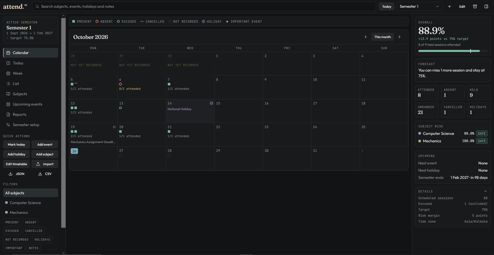
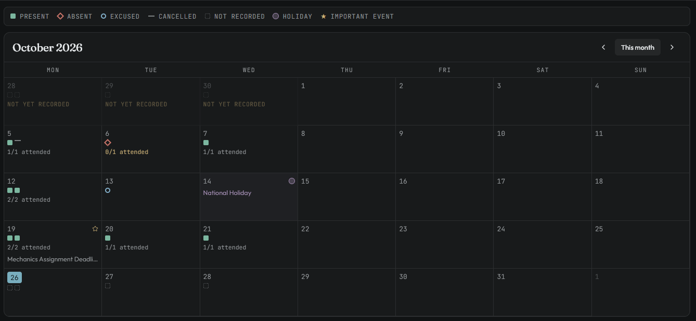
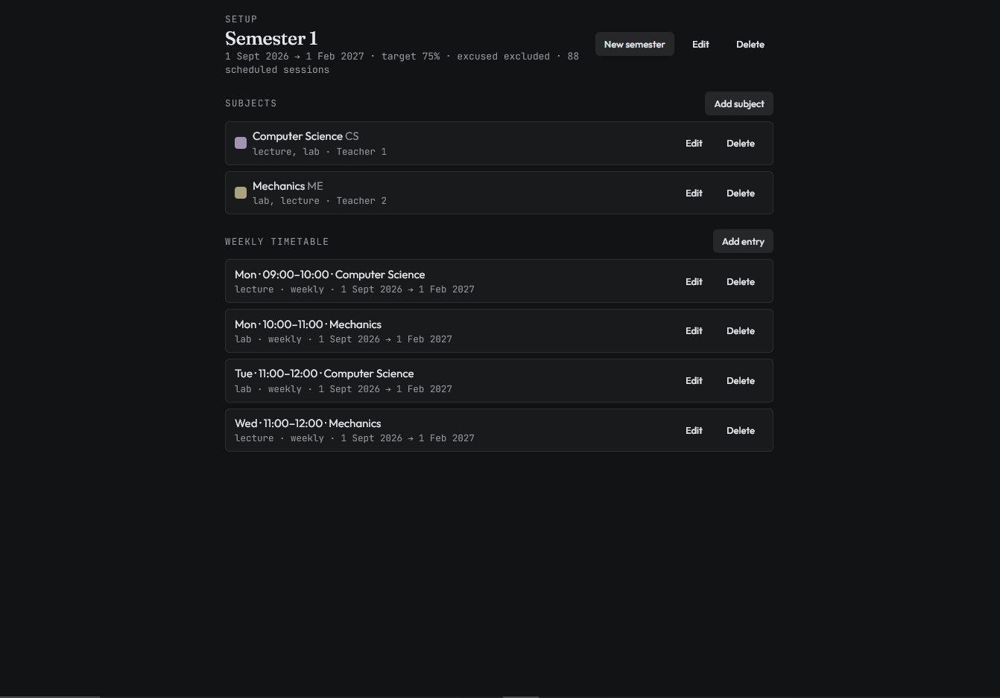
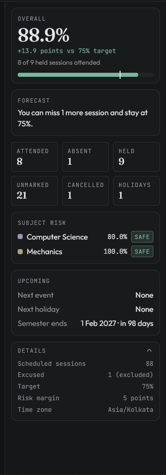

[README.md](https://github.com/user-attachments/files/33957632/README.md)
# Attend.™

**A local-first attendance planner for college students.** Track classes across a semester, understand your attendance percentage, and forecast how many sessions you can miss or need to attend to reach your target, all without ever creating an account.

[](https://attend-pv.vercel.app/)

[](https://react.dev/)

[](https://www.typescriptlang.org/)

[](https://vite.dev/)

> **Important:** Attend.™ is a personal planning aid, not your college's official attendance register. Confirm important academic decisions with your institution's records.

## Why Attend.™?

Keeping track of attendance across multiple subjects can become tedious—especially when holidays, cancelled classes, excused sessions, and semester targets all affect the final percentage. Attend.™ brings those records together in a calendar-led interface and makes the calculation rules visible.

The project is built around three ideas:

- **Clarity:** view attendance by date, week, session, subject, and semester.
- **Useful forecasts:** see where you stand against a target and how upcoming sessions may affect it.
- **Local-first privacy:** attendance records are stored and processed in your browser; there is no account to create.

## Features



### Attendance and calendar

- Mark sessions as **present, absent, excused, or cancelled**.
- View records in calendar, today, week, and list views.
- Filter records by subject and status, including holidays, important events, and notes.
- Add notes and flag important dates for quick reference.



### Semester and timetable planning

- Configure a semester and its attendance target.
- Organise subjects and timetable sessions.
- Record holidays and upcoming events alongside attendance.
- Review sessions over a selected date range.



### Reports and forecasts

- View overall attendance and counted-session totals.
- Estimate how many consecutive sessions can be missed while staying at or above the configured target.
- When below target, estimate how many consecutive sessions need to be attended to recover to the target.
- Print reports or export report data as CSV or JSON.



### Data portability

- Import supported data and export a JSON backup.
- Keep a separate backup before clearing browser data or moving to another device.

> Feature note: the list above describes the current deployed interface. The exact behaviour of calculations depends on the semester's attendance settings.

## How attendance is calculated

Attend.™ calculates attendance using **(counted attendance ÷ counted sessions) × 100**. The session rules are designed to avoid treating every calendar day as a class:

| Session status |                     How it affects the calculation                           |
| -------------- | ---------------------------------------------------------------------------- |
| Present        | Counted as attended and included in the denominator                          |
| Absent         | Included in the denominator, but not in counted attendance                   |
| Cancelled      | Excluded                                                                     |
| Holiday        | Excluded                                                                     |
| Future session | Excluded until it becomes a past session                                     |
| Not recorded   | Excluded                                                                     |
| Excused        | Depends on the semester rule: count as attended, exclude, or count as absent |

Forecasts use the configured target and the counted sessions. Values are calculated at full precision and rounded for display. Treat forecasts as estimates based on the records and settings you enter—not as a guarantee of how your college will calculate attendance.

## Privacy and data storage

Attend.™ is designed to keep attendance records local to the browser:

- No account or sign-in is required.
- Attendance entries and calculations are stored and processed in the browser rather than in an Attend.™ account.
- The project states that attendance data is not collected or transmitted to its servers.

**Local storage also means you are responsible for backups.** Your records may be lost if you clear site data, use private browsing, switch browsers or devices, or lose access to the device. Export a JSON backup regularly and keep it somewhere safe. Do not rely on the website as the only copy of your records.

The interface loads web fonts from a third-party font service; refer to the website's Terms of Service for the details. No attendance records should be included in public bug reports or screenshots.

## Try it online

Open the deployed application: **[attend-pv.vercel.app](https://attend-pv.vercel.app/)**

For a meaningful first run, open **Semester setup**, create a semester, add subjects and timetable sessions, and then record a few sessions. The Today, Week, Subjects, and Reports pages become more useful after you have entered your schedule and records.

## Run locally

### Prerequisites

- [Git](https://git-scm.com/)
- [Bun](https://bun.sh/) (recommended; the repository includes a Bun lockfile)

### Setup

```bash
git clone https://github.com/prabhav-vijay/attend.git
cd attend
bun install
bun run dev
```

Use the local URL printed by the development server in your terminal.

### Available scripts

|       Command       |               Purpose                |
| ------------------- | ------------------------------------ |
| `bun run dev`       | Start the local development server   |
| `bun run build`     | Create a production build            |
| `bun run build:dev` | Create a development-mode build      |
| `bun run preview`   | Preview the production build locally |
| `bun run lint`      | Run ESLint                           |
| `bun run format`    | Format files with Prettier           |

Run a production build before publishing changes:

```bash
bun run lint
bun run build
```

The current `package.json` does not define a test script. Attendance calculations, import/export, date boundaries, and browser-storage persistence should therefore be checked manually before a release until automated tests are added.

## Development workflow

A practical change cycle for this project is:

1. **Reproduce the issue** with a small, non-sensitive example semester.
2. **Make one focused change** and keep calculation rules separate from presentation where practical.
3. **Check edge cases**—especially semester boundaries, cancelled sessions, holidays, excused-session policies, and empty or malformed imports.
4. **Run lint and build** with the commands above.
5. **Manually verify the affected views** and confirm that data can still be exported and restored.
6. **Update the documentation** when a user-facing feature or calculation rule changes.

Do not use real student records or personal attendance exports when creating screenshots, sample data, bug reports, or test fixtures.

## Technology stack

- **React 19** and **TypeScript** for the interface and application logic
- **TanStack Start** and **TanStack Router** for application routing
- **Vite** for the development/build toolchain
- **Tailwind CSS 4** for styling
- **Radix UI** primitives and related UI utilities for interface components
- **date-fns** for date-related utilities
- **Bun** for dependency installation and project scripts

## AI-assisted development

AI-assisted tooling, including the Lovable development toolchain present in this repository, may be used to accelerate scaffolding, implementation, debugging, and iteration. Generated suggestions are not automatically assumed to be correct: changes should be reviewed, tested, and understood before being kept.

**Maintainer note:** Edit this section before publishing if it does not accurately describe how AI tools were used on this project. Name only tools and uses that reflect your actual workflow.

## Roadmap ideas

These are potential improvements, not promises or claims that the work is already underway:

- Add automated tests for attendance percentages, target forecasts, and date-boundary cases.
- Add schema validation and clearer recovery messages for imported backups.
- Improve backup/versioning guidance so users can recognise stale or incompatible exports.
- Expand accessibility and small-screen testing across calendar, setup, and report views.
- Add a concise changelog and document any changes to attendance rules.

## Feedback and issue reports

Bug reports and feature suggestions can be submitted through [GitHub Issues](https://github.com/prabhav-vijay/attend/issues), where available. Helpful reports include the page, steps to reproduce, expected behaviour, and actual behaviour.

Alternatively, you can contact the developer directly at contact.attend.dev@gmail.com.

**Do not attach attendance exports, personal information, screenshots containing student details, or other private records to a public issue.** Use a fabricated example instead.

## Terms, ownership, and reuse

- [Live application](https://attend-pv.vercel.app/)
- [About Attend.™](https://attend-pv.vercel.app/about)
- [Terms of Service](https://attend-pv.vercel.app/terms)


Built as a student project to make everyday college attendance easier to record, understand, and plan around.
